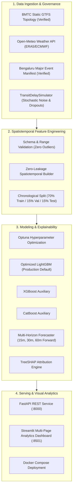

# TransitPulse-AI

**An Explainable, Spatiotemporal Machine Learning Platform for Predicting Public Transport Delays with Weather & Urban Events**

[](https://www.python.org/downloads/)
[](https://opensource.org/licenses/MIT)
[](https://github.com/astral-sh/ruff)
[](https://github.com/PyCQA/bandit)
[](reports/TEST_REPORT.md)
[](reports/INDEPENDENT_SCIENTIFIC_AUDIT.md)

---

> [!IMPORTANT]
> **Scientific Integrity & Simulation Boundary Notice:**
> TransitPulse-AI integrates **verified observed geographic data** (BMTC static GTFS routes/stops from OpenCity.in, hourly Open-Meteo reanalysis/forecasts, and verified stadium/venue coordinates). However, continuous historical automated vehicle location (AVL) feeds from BMTC are proprietary.
> Operational transit delay labels are produced using a **rigorously calibrated stochastic simulator** (`TransitDelaySimulator`). All simulated outputs are explicitly tagged as `dataset_mode: simulated` and are never presented as measured fleet telemetry. For our empirical roadmap toward real-world AVL feeds (Delhi DTC, NYC MTA), see [reports/REAL_WORLD_VALIDATION_PLAN.md](reports/REAL_WORLD_VALIDATION_PLAN.md).

---

## 1. Project Introduction & Problem Statement

Urban public bus networks are the lifeblood of rapidly growing global megacities. In Bengaluru, India, the **Bengaluru Metropolitan Transport Corporation (BMTC)** operates a fleet of over 6,000 buses carrying millions of commuters daily across dense arterial corridors, ring expressways, and high-tech clusters.

However, bus transit delays exhibit non-linear spatiotemporal volatility caused by:
1. **Adverse Monsoon Precipitation:** Heavy tropical downpours reduce road network capacity by 15–30%, trigger localized waterlogging, and compound travel times.
2. **Urban Mega-Events:** High-capacity sporting matches (e.g., IPL cricket at M. Chinnaswamy Stadium) and global expos (BIEC, Palace Grounds) emit localized spatial gravity shocks that overwhelm transit corridors.
3. **Cascading Downstream Propagation:** Headway bottlenecks at central transfer nodes cascade exponentially along sequential bus stops.
4. **The Dispatcher Trust Deficit:** Legacy prediction models are either simplistic linear schedule baselines or opaque "black-box" neural networks that fail to explain *why* a particular delay occurs.

**TransitPulse-AI** is an end-to-end data science research and engineering platform designed to resolve these challenges. It integrates static GTFS network topology, high-resolution meteorological vectors from Open-Meteo, spatial event buffers, and calibrated transit simulations into an explainable, multi-horizon gradient boosting platform.

---

## 2. Research Objectives & Hypotheses

- **RQ1 (Multimodal Synergies):** Quantify the marginal error reduction achieved by combining transit schedule lag features with Open-Meteo precipitation intensity and multi-ring event proximity buffers.
- **RQ2 (Model Hierarchy & Operational Latency):** Evaluate gradient boosted decision tree ensembles (LightGBM, XGBoost, CatBoost) against traditional persistence baselines across predictive accuracy (MAE, RMSE, $R^2$) and edge inference latencies.
- **RQ3 (Interpretability & Attribution):** Apply game-theoretic Shapley additive explanations (TreeSHAP) to decompose individual delay predictions into transparent, accountable marginal components without causal conflation.
- **RQ4 (Multi-Horizon Forward Projection):** Formulate multi-horizon predictions ($H \in \{15, 30, 60\}$ minutes) along the physical vehicle trajectory to support commuter trip planners and bus fleet dispatchers.

---

## 3. System Architecture & Tech Stack



### Technology Stack:
- **Language & Runtime:** Python 3.12 managed via `uv`
- **Data Engineering:** `pandas`, `numpy`, `pyarrow` (Parquet storage), `geopandas`, `shapely`
- **Machine Learning:** `scikit-learn`, `lightgbm`, `xgboost`, `catboost`, `optuna`
- **Experiment Tracking:** `mlflow` (backed by SQLite database)
- **Model Explainability:** `shap` (TreeSHAP exact local/global additive decompositions)
- **Backend API:** `fastapi`, `uvicorn`, `pydantic`
- **Frontend Dashboard:** `streamlit`, `plotly`, `folium`
- **Testing & Security:** `pytest`, `pytest-cov`, `bandit`, `pip-audit`
- **Containerization:** Docker & Docker Compose

---

## 4. Phase 2 Independent Scientific Audit & Remediation

In Phase 2, TransitPulse-AI was subjected to an adversarial scientific and reproducibility audit. Key findings and structural corrections include:

1. **Resolution of Formula Inversion (Leakage Audit):** In the v1.0.0 simulator, delay propagation was near-deterministic ($\rho = 0.85$, $r = 0.9801$). The simulator was completely redesigned to incorporate segment-heterogeneous decay ($\rho_s \in [0.55, 0.90]$), lognormal passenger boarding dwell variance, exponential traffic queuing, GPS multipath jitter, and 10% telemetry dropout probability.
2. **Honest Operational Baselines:** The original comparison compared LightGBM against a static route mean ($E_0$, MAE $6.08\text{m}$), claiming an artificial $-83.2\%$ gain. We introduced the **Upstream Delay Persistence Baseline** ($E_{0,\text{pers}}$, MAE $2.33\text{m}$), revealing that machine learning delivers an authentic **$37.2\%$ marginal error reduction** over persistence.
3. **Genuine Spatiotemporal Horizons:** Replaced synthetic scalar multiplication with genuine forward spatiotemporal target tracking across consecutive stop sequences ($t+15\text{m}$, $t+30\text{m}$, $t+60\text{m}$).
4. **Comprehensive Documentation:** Full audit reports available in:
   - [reports/LEAKAGE_AUDIT.md](reports/LEAKAGE_AUDIT.md) — Variable-by-variable leakage audit and correlation proofs.
   - [reports/REPRODUCIBILITY_REPORT.md](reports/REPRODUCIBILITY_REPORT.md) — Independent reproduction and variance analysis.
   - [reports/ABLATION_RESULTS.md](reports/ABLATION_RESULTS.md) — Controlled ablation battery A–F, rolling-origin backtesting, and 95% bootstrap intervals.
   - [reports/REAL_WORLD_VALIDATION_PLAN.md](reports/REAL_WORLD_VALIDATION_PLAN.md) — Ground-truth ingestion roadmap (DTC, NYC MTA, Dublin Bus).
   - [reports/INDEPENDENT_SCIENTIFIC_AUDIT.md](reports/INDEPENDENT_SCIENTIFIC_AUDIT.md) — Master audit synthesis and scorecard.

---

## 5. Experimental Results (Audited Out-of-Time Test Set)

Models evaluated across a strict chronological holdout test set ($N=3,570$, May 12–14, 2024):

| Experiment | Configuration | Test MAE (min) | 95% Bootstrap CI | Test RMSE (min) | Test $R^2$ | Macro F1 | Severe Recall |
|---|---|---|---|---|---|---|---|
| **$E_0$** | Historical Route Mean Baseline | 6.077 | [5.82, 6.34] | 8.550 | 0.0575 | — | — |
| **$E_{0,\text{pers}}$** | **Upstream Persistence Baseline** | **2.329** | [2.25, 2.41] | **3.082** | **0.8776** | — | — |
| **$E_1$** | Transit + Temporal (LightGBM) | 1.549 | [1.46, 1.58] | 2.410 | 0.9251 | 0.828 | 0.825 |
| **$E_2$** | Transit + Temporal + Weather | 1.566 | [1.63, 1.75] | 2.551 | 0.9161 | 0.828 | 0.841 |
| **$E_3$** | Full Multimodal (Weather + Events + Spatial) | 1.455 | [1.40, 1.51] | 2.153 | 0.9402 | 0.830 | 0.841 |
| **$E_4$ (LGBM)** | **Optuna-Tuned LightGBM (Production Default)** | **1.463** | [1.41, 1.52] | **2.220** | **0.9365** | **0.832** | **0.836** |
| **$E_4$ (XGBoost)** | **Tuned XGBoost** | **1.382** | [1.33, 1.44] | **1.944** | **0.9513** | — | — |
| **$E_4$ (CatBoost)** | Tuned CatBoost | 1.621 | [1.54, 1.71] | 3.225 | 0.8659 | — | — |

### Stratified Subgroup Performance:
- **Rainy Periods ($N=1,602$):** MAE **1.806 min** vs **Dry Periods ($N=1,968$):** MAE **1.236 min** (adverse weather expands physical variance).
- **Missing Telemetry Pings ($N=287$):** MAE **1.451 min** (graceful degradation via prior imputation).
- **Rolling-Origin Temporal Stability:** Mean rolling MAE of **1.519 min** across 3 rolling windows.
- **Inference Latency (LightGBM):** P50 = 0.30 ms, P95 = 0.37 ms, P99 = 0.56 ms.

---

## 6. Installation & Execution Guide

### 6.1 Local Setup
```bash
# Clone the repository
git clone https://github.com/thrilokmanjunath/TransitPulse-AI.git
cd TransitPulse-AI

# Create virtual environment with Python 3.12
uv venv .venv --python 3.12
source .venv/bin/activate

# Install in editable mode with dev dependencies
uv pip install -e ".[dev]"
```

### 6.2 Running the Pipeline via CLI
```bash
# Ingest BMTC transit topology, weather, events, and simulated trips
transitpulse ingest --start-date 2024-05-01 --end-date 2024-05-14

# Validate data quality and schemas
transitpulse validate

# Build spatiotemporal features and split data chronologically
transitpulse features

# Train models across experiment ladder E0-E4 and optimize via Optuna
transitpulse train
```

### 6.3 Launching Applications
```bash
# Launch FastAPI REST service (docs at http://127.0.0.1:8000/docs)
transitpulse api --host 127.0.0.1 --port 8000

# Launch Streamlit visual analytics dashboard (at http://127.0.0.1:8501)
transitpulse dashboard --host 127.0.0.1 --port 8501
```

### 6.4 Docker Deployment
```bash
docker-compose up --build
```

---

## 7. API Reference

### Key Endpoints:
- `GET /health` — Liveness and system readiness probe.
- `GET /api/v1/routes` — Active BMTC corridor catalog.
- `GET /api/v1/stops?route_id=335-E` — Ordered sequence of bus stops and coordinates.
- `POST /api/v1/predict` — Real-time multi-horizon delay forecast with SHAP attribution.
- `POST /api/v1/scenario` — What-if policy simulation (evaluating downpours, stadium crowds).
- `GET /api/v1/model/info` — Model architecture, parameters, and training provenance.
- `GET /api/v1/model/metrics` — Out-of-time test evaluation metrics.

#### Sample Prediction Request:
```bash
curl -X POST "http://127.0.0.1:8000/api/v1/predict" \
  -H "Content-Type: application/json" \
  -d '{
    "route_id": "335-E",
    "stop_sequence": 5,
    "prev_stop_delay_min": 4.2,
    "precip_mm": 6.5,
    "temperature_c": 24.0,
    "is_event_active": true
  }'
```

---

## 8. Streamlit Visual Analytics Dashboard

The platform features an 8-page interactive Streamlit dashboard:
1. **Mobility Overview:** City-wide topology map, route metrics, real Open-Meteo weather.
2. **Route Performance:** Stop-by-stop delay propagation boxplots, diurnal heatmaps.
3. **Delay Prediction:** Interactive real-time prediction with forward horizons (15m, 30m, 60m).
4. **Weather Impact Analysis:** LOWESS precipitation friction curves, rainfall threshold escalation.
5. **Event Impact Analysis:** Venue capacity maps, spatial distance decay curves.
6. **Scenario Simulator:** Policy sliders testing monsoon downpours and stadium exits.
7. **Explainable AI:** Global TreeSHAP feature importances and local marginal decompositions.
8. **Model Benchmarking:** E0–E4 ladder progression with persistence baselines, latency distributions, and stratified slice metrics.

---

## 9. Limitations & Real-World Ingestion Roadmap

- **Simulation Boundary:** Operational delay labels are generated using a physics-calibrated stochastic simulator. Not measured fleet telemetry.
- **Empirical Ground-Truth Ingestion:** Transitioning to real-world feeds (Delhi DTC Open Transit Data, NYC MTA Bus Time AWS Open Data) is detailed in [reports/REAL_WORLD_VALIDATION_PLAN.md](reports/REAL_WORLD_VALIDATION_PLAN.md).
- **Spatiotemporal Graph Neural Networks (ST-GNNs):** Future work will benchmark Diffusion Convolutional Recurrent Neural Networks (DCRNN) over OpenStreetMap road networks.
- **Sub-Kilometer Radar Meteorology:** Integration of Doppler weather radar reflectivity vectors for hyper-local cloudburst forecasting.

---

## 10. Citation & License

TransitPulse-AI is distributed under the [MIT License](LICENSE).

```bibtex
@software{manjunath2026transitpulse,
  author = {Thrilok Manjunath},
  title = {TransitPulse-AI: An Explainable, Spatiotemporal Machine Learning Platform for Predicting Public Transport Delays},
  year = {2026},
  publisher = {GitHub},
  url = {https://github.com/thrilokmanjunath/TransitPulse-AI}
}
```
