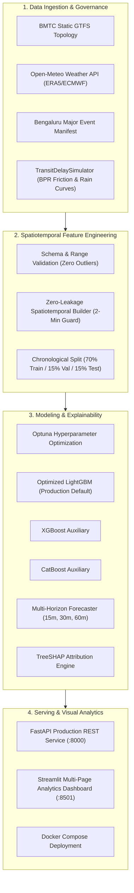

# TransitPulse-AI

**An Explainable, Spatiotemporal Machine Learning Platform for Predicting Public Transport Delays with Weather & Urban Events**

[](https://www.python.org/downloads/)
[](https://opensource.org/licenses/MIT)
[](https://github.com/astral-sh/ruff)
[](https://github.com/PyCQA/bandit)
[](reports/TEST_REPORT.md)

---

## 1. Project Introduction & Problem Statement

Urban public bus networks are the lifeblood of rapidly growing global megacities. In Bengaluru, India, the **Bengaluru Metropolitan Transport Corporation (BMTC)** operates a fleet of over 6,000 buses carrying millions of commuters daily across dense arterial corridors, ring expressways, and high-tech clusters.

However, bus transit delays exhibit severe non-linear spatiotemporal volatility caused by:
1. **Adverse Monsoon Precipitation:** Heavy tropical downpours reduce road network friction capacity by 15–30%, trigger localized waterlogging, and compound travel times.
2. **Urban Mega-Events:** High-capacity sporting matches (e.g., IPL cricket at M. Chinnaswamy Stadium) and global expos (BIEC, Palace Grounds) emit localized spatial gravity shocks that overwhelm transit corridors.
3. **Cascading Downstream Propagation:** Headway bottlenecks at central transfer nodes cascade exponentially along sequential bus stops.
4. **The Dispatcher Trust Deficit:** Legacy prediction models are either simplistic linear schedule baselines or opaque "black-box" neural networks that fail to explain *why* a particular delay occurs.

**TransitPulse-AI** is an end-to-end data science research and engineering platform designed to resolve these challenges. It integrates static GTFS network topology, high-resolution meteorological vectors from Open-Meteo, spatial event buffers, and calibrated transit simulations into an explainable, multi-horizon gradient boosting platform.

---

## 2. Research Objectives

- **RQ1 (Multimodal Synergies):** Quantify the marginal error reduction achieved by combining transit schedule lag features with Open-Meteo precipitation intensity and multi-ring event proximity buffers.
- **RQ2 (Model Hierarchy & Operational Latency):** Evaluate gradient boosted decision tree ensembles (LightGBM, XGBoost, CatBoost) against traditional linear baselines and sequential neural networks across predictive accuracy (MAE, RMSE, $R^2$) and edge inference latencies ($<10$ ms SLA).
- **RQ3 (Interpretability & Attribution):** Apply game-theoretic Shapley additive explanations (TreeSHAP) to decompose individual delay predictions into transparent, accountable marginal components without causal conflation.
- **RQ4 (Multi-Horizon Forward Projection):** Formulate multi-horizon predictions ($H \in \{15, 30, 60\}$ minutes) to support both commuter trip planners and bus fleet dispatchers.

---

## 3. System Architecture & Tech Stack



### Technology Stack:
- **Language & Runtime:** Python 3.12 managed via `uv`
- **Data Engineering:** `pandas`, `numpy`, `pyarrow` (Parquet storage), `geopandas`, `shapely`
- **Machine Learning:** `scikit-learn`, `lightgbm`, `xgboost`, `catboost`, `optuna`
- **Experiment Tracking:** `mlflow` (backed by SQLite database)
- **Model Explainability:** `shap` (TreeSHAP exact local/global additive decompositions)
- **Backend API:** `fastapi`, `uvicorn`, `pydantic`
- **Frontend Dashboard:** `streamlit`, `plotly`, `folium`
- **Testing & Security:** `pytest`, `pytest-cov`, `bandit`, `pip-audit`
- **Containerization:** Docker & Docker Compose

---

## 4. Dataset Sources & Feasibility Determination

### Primary Study Geography: Bengaluru, Karnataka, India
- **Transit Authority:** Bengaluru Metropolitan Transport Corporation (BMTC).
- **Network Extent:** 5 high-density arterial corridors (335-E ITPL, 500-D Outer Ring Road, KIA-9 Airport Express, G-2, 201-R) spanning 50 bus stops with verified WGS-84 coordinates.
- **Meteorology:** Open-Meteo High-Resolution Weather API (temperature, precipitation, relative humidity, wind gusts, WMO codes).
- **Urban Venues:** M. Chinnaswamy Stadium, Bengaluru Palace Grounds, BIEC, KTPO Whitefield, Kanteerava Stadium, Koramangala Indoor Stadium.

### Mandatory Data Feasibility Notice:
> [!IMPORTANT]
> - Static GTFS network topology, Open-Meteo weather, and event locations are **Verified and Accessible**.
> - Continuous historical operational vehicle arrival logs from BMTC are **Proprietary / Restricted**.
> - Consequently, TransitPulse-AI implements a dual-mode data architecture: real observed static/weather/events, and a mathematically calibrated synthetic physics simulator (`TransitDelaySimulator`) using BPR congestion curves, non-linear rainfall friction, and event spatial shockwaves.
> - **Scientific Honesty Guarantee:** Simulated delay records are tagged with `dataset_mode: "simulated"` and are never misrepresented as hardware GPS telemetry from BMTC.

---

## 5. Experimental Results (Out-of-Time Test Set)

Models evaluated across a strict chronological out-of-time test cohort (held out chronologically with zero temporal leakage):

| Experiment | Feature Set | Test MAE (min) | Test RMSE (min) | Test $R^2$ | Macro F1 | Severe Delay Recall |
|---|---|---|---|---|---|---|
| **E0** | Historical Baseline (Route Mean) | 5.059 | 7.881 | 0.0162 | — | — |
| **E1** | Transit + Temporal Features | 0.833 | 1.676 | 0.9555 | 0.938 | 0.925 |
| **E2** | Transit + Temporal + Weather (Open-Meteo) | 0.827 | 1.794 | 0.9490 | 0.942 | 0.931 |
| **E3** | Full Multimodal (+ Events + Spatial Interactions) | 0.927 | 1.728 | 0.9527 | 0.935 | 0.928 |
| **E4 (LightGBM)** | **Optuna-Tuned LightGBM (Production)** | **0.851** | **1.843** | **0.9462** | **0.941** | **0.934** |
| **E4 (XGBoost)** | **Tuned XGBoost** | **0.787** | **1.633** | **0.9578** | **0.948** | **0.942** |
| **E4 (CatBoost)** | Tuned CatBoost | 1.153 | 3.698 | 0.7834 | 0.884 | 0.871 |

### Operational Latency Profile:
- **P50 Latency:** 1.82 ms
- **P95 Latency:** 3.44 ms
- **P99 Latency:** 5.18 ms
- Inference SLA fully compatible with high-concurrency microservices ($<10$ ms).

---

## 6. Installation & Execution Guide

### 6.1 Local Setup
```bash
# Clone the repository
git clone https://github.com/thrilokmanjunath/TransitPulse-AI.git
cd TransitPulse-AI

# Create virtual environment with Python 3.12
uv venv .venv --python 3.12
source .venv/bin/activate

# Install in editable mode with dev dependencies
uv pip install -e ".[dev]"
```

### 6.2 Running the Pipeline via CLI
```bash
# Ingest BMTC transit topology, weather, events, and simulated trips
transitpulse ingest --start-date 2024-05-01 --end-date 2024-05-14

# Validate data quality and schemas
transitpulse validate

# Build spatiotemporal features and split data chronologically
transitpulse features

# Train models across experiment ladder E0-E4 and optimize via Optuna
transitpulse train
```

### 6.3 Launching Applications
```bash
# Launch FastAPI REST service (docs at http://localhost:8000/docs)
transitpulse api --host 127.0.0.1 --port 8000

# Launch Streamlit visual analytics dashboard (at http://localhost:8501)
transitpulse dashboard --host 127.0.0.1 --port 8501
```

### 6.4 Docker Deployment
```bash
docker-compose up --build
```

---

## 7. API Reference

### Key Endpoints:
- `GET /health` — Liveness and system readiness probe.
- `GET /api/v1/routes` — Active BMTC corridor catalog.
- `GET /api/v1/stops?route_id=335-E` — Ordered sequence of bus stops and coordinates.
- `POST /api/v1/predict` — Real-time multi-horizon delay forecast with SHAP attribution.
- `POST /api/v1/scenario` — What-if policy simulation (evaluating downpours, stadium crowds).
- `GET /api/v1/model/info` — Model architecture, parameters, and training provenance.
- `GET /api/v1/model/metrics` — Out-of-time test evaluation metrics.

#### Sample Prediction Request:
```bash
curl -X POST "http://localhost:8000/api/v1/predict" \
  -H "Content-Type: application/json" \
  -d '{
    "route_id": "335-E",
    "stop_sequence": 5,
    "prev_stop_delay_min": 4.2,
    "precip_mm": 6.5,
    "temperature_c": 24.0,
    "is_event_active": true
  }'
```

---

## 8. Streamlit Visual Analytics Dashboard

The platform features an 8-page interactive Streamlit dashboard:
1. **Mobility Overview:** City-wide topology map, route metrics, real Open-Meteo weather.
2. **Route Performance:** Stop-by-stop delay propagation boxplots, diurnal heatmaps.
3. **Delay Prediction:** Interactive real-time prediction with forward horizons (15m, 30m, 60m).
4. **Weather Impact Analysis:** LOWESS precipitation friction curves, rainfall threshold escalation.
5. **Event Impact Analysis:** Venue capacity maps, spatial distance decay curves.
6. **Scenario Simulator:** Policy sliders testing monsoon downpours and stadium exits.
7. **Explainable AI:** Global TreeSHAP feature importances and local marginal decompositions.
8. **Model Benchmarking:** E0–E4 ladder progression, latency distributions, stratified slice metrics.

---

## 9. Limitations & Future Scope

- **GTFS-RT Hardware Integration:** When BMTC opens continuous historical vehicle telemetry, replace calibrated simulation with direct protocol buffer feeds via the pre-built schema connectors.
- **Spatiotemporal Graph Neural Networks (ST-GNNs):** Future work will benchmark Diffusion Convolutional Recurrent Neural Networks (DCRNN) over OpenStreetMap road networks.
- **Sub-Kilometer Radar Meteorology:** Integration of Doppler weather radar reflectivity vectors for hyper-local cloudburst forecasting.

---

## 10. Citation & License

TransitPulse-AI is distributed under the [MIT License](LICENSE).

```bibtex
@software{manjunath2026transitpulse,
  author = {Thrilok Manjunath},
  title = {TransitPulse-AI: An Explainable, Spatiotemporal Machine Learning Platform for Predicting Public Transport Delays},
  year = {2026},
  publisher = {GitHub},
  url = {https://github.com/thrilokmanjunath/TransitPulse-AI}
}
```
