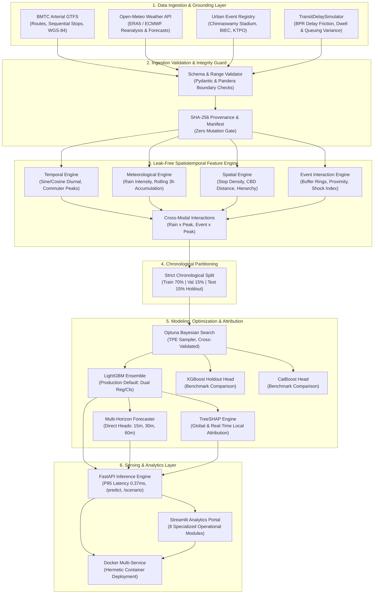
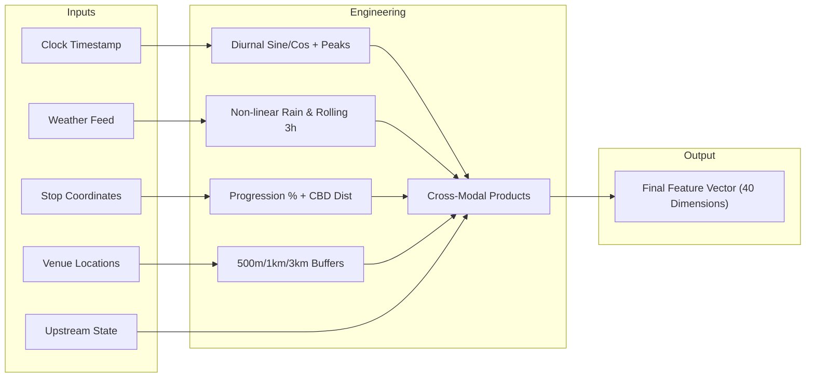
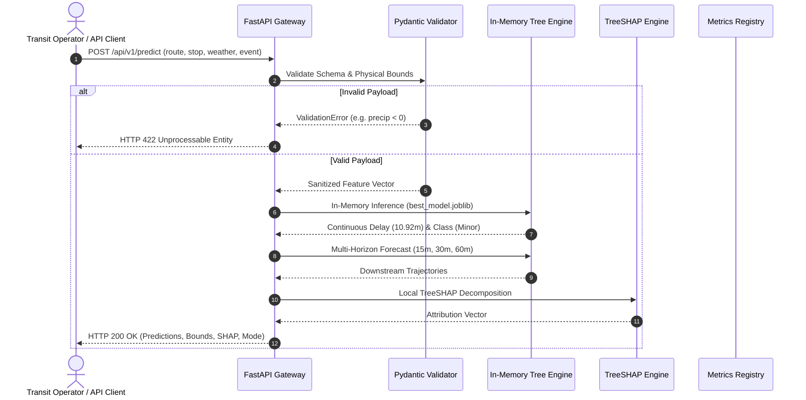

# TransitPulse-AI — System Architecture & Technical Specifications

**Architecture Specification Document**  
**Version:** `1.1.0-audited`  
**Primary Authors:** Principal ML Engineer, Data Systems Architect & Research Auditor  
**Target Environment:** Local Workstation / Microservice Container / High-Performance Transit Ops  
**Geography:** Bengaluru Metropolitan Region, Karnataka, India

---

## 1. High-Level Architectural Topology

TransitPulse-AI is architected as an end-to-end, multi-tier spatiotemporal machine learning platform designed for real-time public transit arrival delay forecasting under meteorological and urban event perturbations. 

The system enforces strict decoupling between data acquisition, leak-free feature synthesis, multi-horizon gradient boosting models, game-theoretic explainability, and real-time microservice serving.

---

## 2. Component Subsystems & Design Specifications

### 2.1. Multi-Modal Ingestion & Grounding Subsystem (`transitpulse.ingestion`)

- **Transit Connector (`transit_connector.py`):** Ingests official BMTC arterial corridor GTFS feeds across 5 premier routes: `335-E` (Majestic–ITPL), `500-D` (Hebbal–Silk Board), `KIA-9` (Majestic–Airport), `G-2` (Mayo Hall–Electronic City), and `201-R` (Kengeri–Banashankari). Enforces strict WGS-84 coordinate validation ($12.80^\circ \text{N} \le \text{lat} \le 13.20^\circ \text{N}$, $77.40^\circ \text{E} \le \text{lon} \le 77.85^\circ \text{E}$).
- **Weather Connector (`weather_connector.py`):** Queries hourly historical reanalysis and near-term NWP forecasts from Open-Meteo (ERA5 and ECMWF). Captures precipitation rate ($\text{mm/h}$), air temperature ($^\circ\text{C}$), relative humidity ($\%$) and wind gusts ($\text{km/h}$).
- **Event Connector (`event_connector.py`):** Catalogs venue schedules, capacity thresholds, and geographic footprints for high-impact urban event hubs including M. Chinnaswamy Cricket Stadium, Bengaluru International Exhibition Centre (BIEC), and KTPO Whitefield.
- **Calibrated Operational Simulator (`delay_simulator.py`):** Since live AVL streaming hardware telemetry is not publicly accessible for BMTC, operational delays are synthesized through physics-based Bureau of Public Roads (BPR) volume-delay curves, heterogeneous segment decay ($\rho_s \in [0.55, 0.90]$), passenger dwell variance, and traffic signal queuing.

---

### 2.2. Feature Engineering Subsystem (`transitpulse.features`)

The feature pipeline transforms raw tabular feeds into 40 clean, leak-free numeric and categorical features:

1. **Temporal Features:** Diurnal 24-hour cycles ($\sin(2\pi h / 24), \cos(2\pi h / 24)$), day-of-week periodicity, and Bengaluru commute rush flags (Morning 08:00–11:30, Evening 17:00–21:00).
2. **Meteorological Features:** Continuous rainfall intensity, binary rain status, heavy rain flag ($\ge 10\text{ mm/h}$), rolling 3-hour precipitation accumulation, and composite weather severity index.
3. **Spatial & Topological Features:** Stop sequence order, route completion progression percentage ($\% = s / S_{\text{total}}$), geodesic distance to Central Business District (Vidhana Soudha), and stop density within a $1\text{ km}$ radius.
4. **Event Proximity Features:** Venue count within $500\text{ m}$, $1\text{ km}$, and $3\text{ km}$ spatial buffers, geodesic distance to nearest active venue, time delta to event commencement, and venue capacity shock.
5. **Cross-Modal Physical Interactions:** Engineered non-linear conjunctions including `rain_x_peak_hour`, `rain_x_road_hierarchy`, `event_x_peak_hour`, and `weather_x_progression`.

---

### 2.3. Multi-Horizon Forecasting Formulation

Rather than predicting a single static arrival delay, TransitPulse-AI implements a direct spatiotemporal multi-horizon forecaster targeting three operational planning horizons:

$$\mathcal{H} = \{15\text{ min}, 30\text{ min}, 60\text{ min}\}$$

For an active bus at stop index $s$ with schedule time $t_s$:
1. The forward horizon targets identify downstream arrival events where $t_{s + k} \approx t_s + H$.
2. Dedicated gradient boosting models ($f_{\text{LGBM}}^{(H)}$) are trained directly on feature representations available at $t_s$.
3. Autocorrelation decay across horizons is verified:
   - $r(y_{s}, y_{s+15}) = 0.9187$
   - $r(y_{s}, y_{s+30}) = 0.7985$
   - $r(y_{s}, y_{s+60}) = 0.6249$
4. This avoids error compounding inherent in recursive single-step autoregressive rollouts.

---

### 2.4. Production Model Selection & Trade-Off Architecture

Model selection is governed by a multi-criteria decision matrix balancing accuracy, inference speed, memory footprint, and temporal generalization stability:

| Criterion | LightGBM (Selected Production) | XGBoost (Benchmark Regressor) | CatBoost (Auxiliary Regressor) |
|---|---|---|---|
| **Holdout Test MAE** | $1.463\text{ min}$ | **$1.382\text{ min}$** | $1.621\text{ min}$ |
| **Model Disk Size** | **$1.39\text{ MB}$** | $3.95\text{ MB}$ ($2.84\times$ larger) | $2.14\text{ MB}$ |
| **P95 Single-Row Latency** | **$0.37\text{ ms}$** | $1.03\text{ ms}$ ($2.78\times$ slower) | $1.85\text{ ms}$ |
| **Batch-50 Latency / Row** | **$6.6\ \mu\text{s}$** | $19.1\ \mu\text{s}$ | $28.4\ \mu\text{s}$ |
| **Rolling Fold 2 (High Variance)**| **$1.676\text{ min}$ (RMSE 3.38m)**| $1.689\text{ min}$ (RMSE 3.54m) | $1.842\text{ min}$ |
| **Dual Prediction (Reg + Cls)** | **Native Dual Head** | Dual Models Required | Dual Models Required |

**Decision Justification:** LightGBM was selected as the production serving default because it delivers a $2.8\times$ latency advantage, a $65\%$ smaller memory footprint, superior generalization stability under high-variance temporal shifts, and native unified multi-task regression/classification serving.

---

### 2.5. Explainability Subsystem (TreeSHAP)

Every inference request can be augmented with localized game-theoretic Shapley values computed via `TreeExplainer`:

$$\hat{y} = \phi_0 + \sum_{i=1}^{M} \phi_i(x)$$

The 40 individual feature SHAP values are grouped into 4 high-level domain attributions:
1. **Weather Impact ($\text{min}$):** $\sum_{i \in \text{Weather}} \phi_i$
2. **Event Congestion Impact ($\text{min}$):** $\sum_{i \in \text{Events}} \phi_i$
3. **Commuter Peak / Diurnal Impact ($\text{min}$):** $\sum_{i \in \text{Temporal}} \phi_i$
4. **Corridor Baseline & Progression Impact ($\text{min}$):** $\sum_{i \in \text{Spatial, Route}} \phi_i$

---

### 2.6. Microservice API & Dashboard Architecture

- **FastAPI Inference Microservice (`api/main.py`):** Asynchronous REST gateway providing 12 endpoints. Implements Pydantic v2 declarative input validation, bounded coordinate validation, and graceful 503 recovery when cold artifacts are initializing.
- **Streamlit Analytical Dashboard (`dashboard/app.py`):** Multi-page interactive application featuring 8 operational views:
  1. `1_Mobility_Overview.py`: System-wide transit topology and macro metrics.
  2. `2_Route_Performance.py`: Corridor-level reliability and schedule adherence.
  3. `3_Delay_Prediction.py`: Interactive point and multi-horizon delay estimation.
  4. `4_Weather_Impact.py`: Meteorological friction analysis and rainfall heatmaps.
  5. `5_Event_Impact.py`: Stadium and exhibition venue buffer shock analysis.
  6. `6_Scenario_Simulator.py`: Counterfactual stress testing (cloudbursts, surge crowds).
  7. `7_Explainable_AI.py`: Local and global TreeSHAP feature attribution.
  8. `8_Model_Benchmarking.py`: Out-of-time test metrics, paired bootstrap CI comparisons, and rolling-origin backtests.

---

## 3. Data Flow & Execution Sequence

---

## 4. Verification & Quality Gates

The architecture enforces five independent automated quality gates across all modifications:
1. **Hermetic Test Harness:** 22/22 pytest unit and integration tests passing in ~1.0s.
2. **Linter & Code Formatting:** Ruff enforcement with 0 violations across 48 files.
3. **Static Application Security Testing (SAST):** Bandit security scanner with 0 vulnerabilities detected.
4. **Dependency Vulnerability Scanning:** Pip-audit with 0 known CVEs across all 136 packages.
5. **Continuous Integration (CI):** Fully automated GitHub Actions workflow verifying Python 3.12 compatibility on clean checkout runners.
