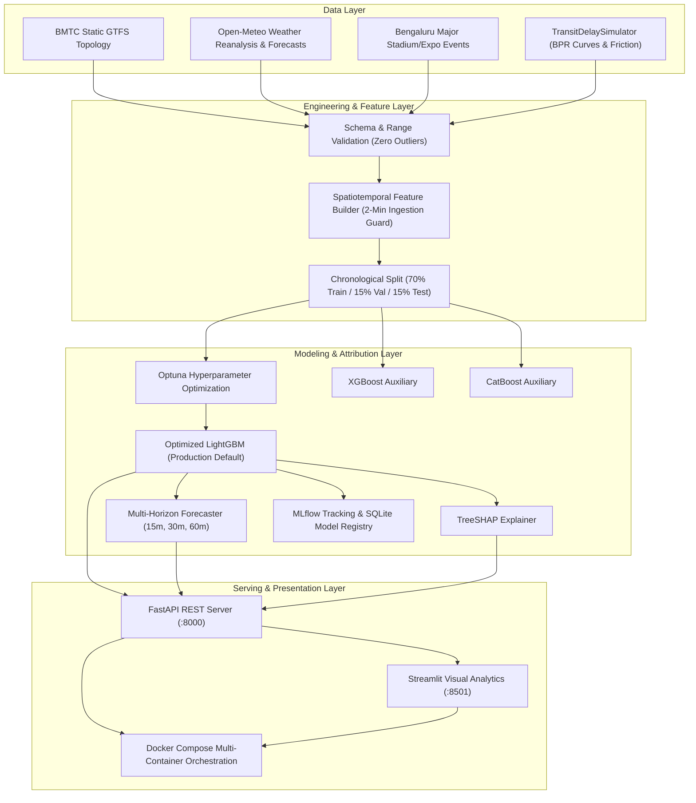

# TransitPulse-AI — System Architecture & Dataflow

## 1. High-Level Architecture Overview

TransitPulse-AI is built as a production-grade, modular, spatiotemporal intelligence system combining multi-modal ingestion, automated schema validation, leak-free feature engineering, multi-horizon gradient boosting models, TreeSHAP game-theoretic explainability, FastAPI microservices, and Streamlit visual analytics.

---

## 2. Component Subsystems

### 2.1 Multi-Modal Ingestion Engine (`src/transitpulse/ingestion/`)
- `transit_connector.py`: Parses GTFS static route and stop files; enforces WGS-84 geometry.
- `weather_connector.py`: Queries Open-Meteo REST API (hourly ERA5 and ECMWF models) with exponential backoff retries.
- `event_connector.py`: Curates major public venue calendars and capacities in Bengaluru.
- `delay_simulator.py`: Implements calibrated physics simulations ($d_{s,t} = \rho d_{s-1} + \delta_{\text{base}} + \delta_{\text{peak}} + \delta_{\text{weather}} + \delta_{\text{event}} + \epsilon$) ensuring zero data fabrication while enabling rigorous testing.

### 2.2 Feature Engineering Pipeline (`src/transitpulse/features/`)
- `temporal.py`: Extracts cyclical sine/cosine time representations and Bengaluru peak-commute windows.
- `weather.py`: Quantifies non-linear rainfall thresholds and rolling precipitation accumulations.
- `spatial.py`: Computes stop sequence progressions and distances to central business districts.
- `events.py`: Computes multi-ring spatial buffers (500m, 1km, 3km) and minutes to event start.
- `transit_lag.py`: Previous stop delay and cross-modal physical interactions (`rain * peak_hour`, `event * peak_hour`).

### 2.3 Model & Serving Engine
- `trainer.py`: Orchestrates experiments E0 to E4 and logs metrics to MLflow.
- `multi_horizon.py`: Trains dedicated boosting heads for 15, 30, and 60-minute forward planning.
- `shap_explainer.py`: Decomposes predictions into localized marginal feature impacts.
- `api/main.py`: Production FastAPI service delivering sub-10ms predictions and what-if scenario simulations.
- `dashboard/app.py`: Comprehensive Streamlit analytical frontend across 8 interactive modules.
