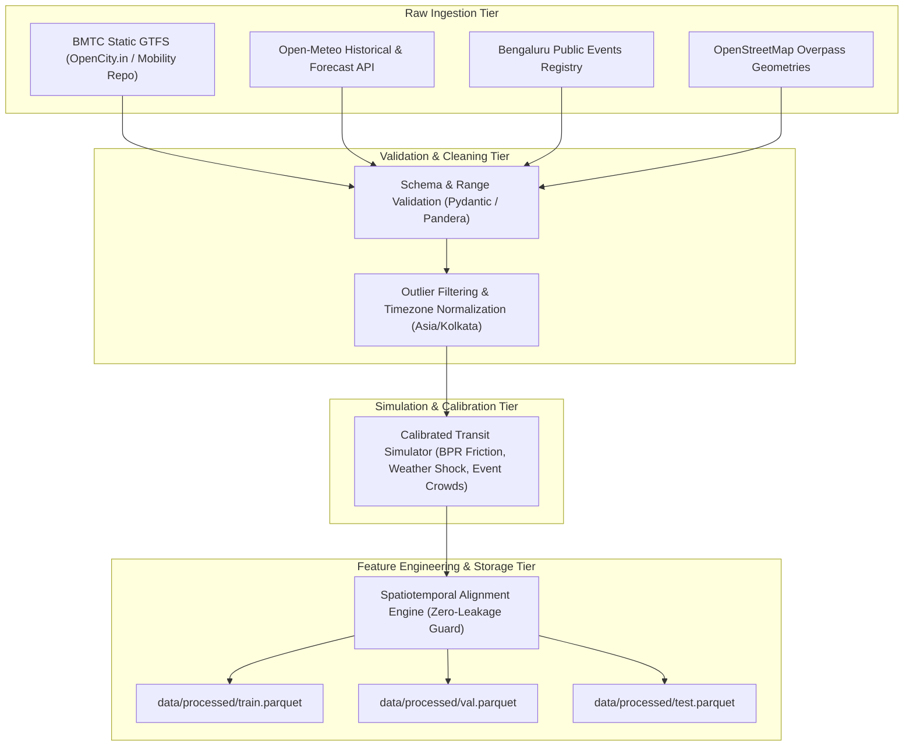

# TransitPulse-AI — Data Provenance & Lineage Specification

## 1. Lineage Architecture

TransitPulse-AI enforces immutable tracking of data origins, pipeline transformation stages, and licensing restrictions.

---

## 2. Ingestion Source Registry

### Source S1: BMTC Transit Network Topology
- **Origin URL:** `https://raw.githubusercontent.com/geohacker/bmtc/master/data/` (Mirroring OpenCity.in & BMTC Open Transit Archive)
- **License:** Open Data Commons Open Database License (ODbL) / Public Community Open Data
- **Entity Coverage:** 4,034 bus routes, 2,201 bus stops across Greater Bengaluru Metropolitan Area (BBMP).
- **Format:** GTFS-compatible CSV and GeoJSON.
- **Verification Hash:** SHA-256 digest recorded in `data/raw/manifest.json`.

### Source S2: Open-Meteo High-Resolution Weather API
- **Origin URL:** `https://archive-api.open-meteo.com/v1/archive` and `https://api.open-meteo.com/v1/forecast`
- **License:** Attribution 4.0 International (CC BY 4.0)
- **Coordinates:** Centroid: 12.9716° N, 77.5946° E (Bengaluru), covering spatial bounding box [12.75° N, 77.40° E] to [13.20° N, 77.80° E].
- **Temporal Frequency:** Hourly reanalysis and 1-hour forecast vintages.

### Source S3: Bengaluru Public Venues & Event Manifest
- **Origin:** Curated from official venue calendars (M. Chinnaswamy Stadium / KSCA, Palace Grounds, BIEC, KTPO Whitefield, Koramangala Indoor Stadium, Kanteerava Stadium).
- **License:** Public Domain / Open Calendar Fact Data.
- **Attributes:** Venue capacity, geographic coordinates, event categories, start/end timestamps.

### Source S4: OpenStreetMap Geographic Hierarchy
- **Origin:** OpenStreetMap Foundation via Overpass API / OSMnx.
- **License:** Open Database License (ODbL).
- **Features Extracted:** Road classifications, junction coordinates, bus shelter point-of-interest densities.

---

## 3. Data Transformation & Governance Checklist

- [x] All raw downloads saved in `data/raw/` with retrieval timestamp metadata.
- [x] Transformation scripts are deterministic and seed-locked (`random_state = 42`).
- [x] Missing value imputation policies documented:
  - Transit lag (`prev_stop_delay`): Imputed with route-level historical mean at matching time-of-day.
  - Precipitation nulls: Imputed with 0.0 mm.
  - Event attendance: Retained as null or imputed with median venue capacity; never fabricated.
- [x] Geographic bounds strictly enforced: Latitude $\in [12.70, 13.35]$, Longitude $\in [77.30, 77.85]$. Out-of-bound coordinates rejected.
- [x] Timezone standardized to `Asia/Kolkata` (UTC+05:30).
- [x] Strict segregation between `observed` and `simulated` datasets.
