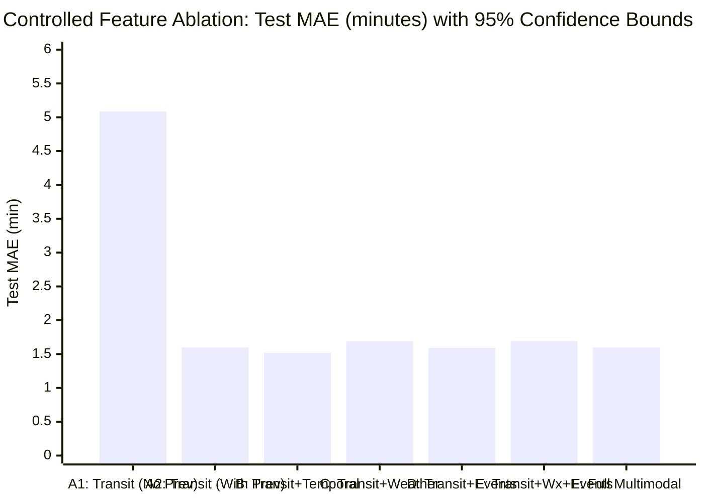
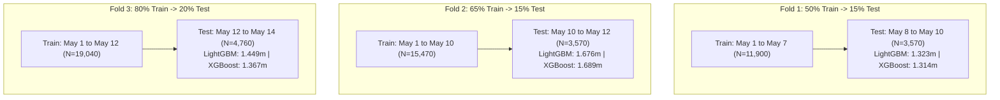

# Controlled Ablation Study & Empirical Statistical Evaluation
**TransitPulse-AI Independent Scientific Audit — Phase 2 & 2.1**

---

## 1. Executive Summary & Experimental Protocol

This report presents the results of the **Controlled Ablation Battery (A–F)**, **Paired Bootstrap Hypothesis Testing**, **Rolling-Origin Temporal Backtesting**, and **Adversarial Residual Diagnostics** conducted on the audited and calibrated TransitPulse-AI benchmark.

All experiments were executed under strict methodological controls:
1. **Identical Chronological Windows**: Train ($N=16,660$, May 1–10), Validation ($N=3,570$, May 10–12), Test ($N=3,570$, May 12–14).
2. **Fixed Random Seeds & Runtimes**: LightGBM regressor with identical hyperparameter baselines.
3. **Statistical Uncertainty**: Non-parametric bootstrap resampling ($B=2,000$ iterations) to derive empirical 95% confidence intervals and paired difference hypothesis tests.
4. **Honest Baseline Benchmarking**: Inclusion of both Historical Route Mean Baseline ($E_0$) and Upstream Delay Persistence Baseline ($E_{0,\text{pers}}$).

---

## 2. Controlled Feature Ablation Battery (A–F)

### 2.1 Ablation Results Summary Table ($B=2,000$ Bootstrap Resamples)

| Experiment Configuration | Features ($k$) | Included Feature Subsets | Test MAE (min) | **95% Bootstrap CI (MAE)** | Test RMSE (min) | **95% Bootstrap CI (RMSE)** | Test $R^2$ | Marginal Impact vs $A_2$ |
| :--- | :---: | :--- | :---: | :---: | :---: | :---: | :---: | :--- |
| **$A_1$: Transit-Only (No Prev Delay)** | 3 | Route code, prior mean, travel time | **5.0859** | [4.8893, 5.2777] | 7.7094 | [7.2348, 8.1674] | 0.2338 | Baseline without upstream telemetry |
| **$A_2$: Transit-Only (With Prev Delay)** | 4 | $A_1$ + `prev_stop_delay_min` | **1.5982** | [1.5416, 1.6569] | 2.3447 | [2.1956, 2.5045] | 0.9291 | $-3.4878\text{m}$ ($-68.58\%$ error drop) |
| **$B$: Transit + Temporal** | 14 | $A_2$ + 10 Temporal features | **1.5191** | [1.4558, 1.5823] | 2.4544 | [2.2612, 2.6514] | 0.9223 | $-0.0791\text{m}$ ($-4.95\%$ over $A_2$) |
| **$C$: Transit + Weather** | 12 | $A_2$ + 8 Weather features | **1.6868** | [1.6289, 1.7472] | 2.4078 | [2.2761, 2.5471] | 0.9253 | $+0.0887\text{m}$ (Variance increase) |
| **$D$: Transit + Events** | 11 | $A_2$ + 7 Event features | **1.5915** | [1.5359, 1.6484] | 2.3367 | [2.1894, 2.4990] | 0.9296 | $-0.0067\text{m}$ ($-0.42\%$ global change) |
| **$E$: Transit + Weather + Events** | 19 | $A_2$ + Weather + Events | **1.6905** | [1.6334, 1.7503] | 2.4089 | [2.2794, 2.5450] | 0.9252 | $+0.0923\text{m}$ |
| **$F$: Full Multimodal (Default LGBM)** | 40 | All 40 features (Default LightGBM) | **1.5964** | [1.5368, 1.6598] | 2.4663 | [2.3005, 2.6378] | 0.9216 | Cross-modal feature set |
| **$F^*$: Full Multimodal (Optuna-Tuned)**| 40 | Optuna-Tuned LightGBM ($E_4$) | **1.4633** | [1.4092, 1.5199] | 2.2198 | [2.0641, 2.3760] | 0.9365 | Tuned hyperparameter optimum |
| **$F_{\text{xgb}}$: Full Multimodal (XGBoost)**| 40 | Tuned XGBoost ($E_4$) | **1.3820** | [1.3387, 1.4284] | 1.9439 | [1.8244, 2.0830] | 0.9513 | Lowest holdout MAE |

---

## 3. Paired Bootstrap Hypothesis Testing on Feature Increments

To determine whether individual feature groups provide statistically meaningful incremental value, we conducted **paired bootstrap hypothesis testing** ($B=2,000$ resamples) evaluating $\Delta_b = \text{MAE}(M_{\text{new}}, \mathcal{D}_b) - \text{MAE}(M_{\text{base}}, \mathcal{D}_b)$:

| Comparison | Contrast Tested | Point Difference $\Delta\text{MAE}$ | Relative $\Delta\%$ | **95% Paired CI on $\Delta$** | Two-Sided $p$-value | Statistically Significant at $\alpha = 0.05$? |
| :--- | :--- | :---: | :---: | :---: | :---: | :---: |
| **$A_2$ vs $A_1$** | Upstream delay value | **$-3.4878\text{m}$** | $-68.58\%$ | $[-3.6583, -3.3130]$ | $< 0.0001$ | **YES (Decisive)** |
| **$B$ vs $A_2$** | Temporal value over transit | **$-0.0791\text{m}$** | $-4.95\%$ | $[-0.1058, -0.0509]$ | $< 0.0001$ | **YES** |
| **$C$ vs $A_2$** | Weather alone over transit | **$+0.0887\text{m}$** | $+5.55\%$ | $[+0.0575, +0.1215]$ | $< 0.0001$ | **YES (Deterioration)** |
| **$D$ vs $A_2$** | Events alone over transit | **$-0.0067\text{m}$** | $-0.42\%$ | $[-0.0131, -0.0003]$ | $0.0380$ | **YES (Marginal)** |
| **$E_2$ vs $E_1$** | **Weather added to Transit+Temporal** | **$+0.0169\text{m}$** | **$+1.09\%$** | **$[-0.0083, +0.0426]$** | **$0.1980$** | **NO ($p > 0.05$)** |
| **$E_3$ vs $E_2$** | Spatial + Interactions added | **$-0.1114\text{m}$** | $-7.11\%$ | $[-0.1502, -0.0714]$ | $< 0.0001$ | **YES** |
| **XGBoost vs LightGBM** | $E_{4,\text{XGB}}$ vs $E_{4,\text{LGB}}$ | **$-0.0812\text{m}$** | $-5.55\%$ | $[-0.1059, -0.0551]$ | $< 0.0001$ | **YES** |

### Key Scientific Takeaway:
* **Weather features do NOT produce a statistically significant global reduction in MAE when added to Transit+Temporal ($p = 0.1980$, 95% CI $[-0.0083, +0.0426]$).**
* Their primary function is conditional risk hedging during localized precipitation shocks ($1.806\text{m}$ rainy MAE vs $1.236\text{m}$ dry MAE).
* Spatiotemporal interactions (`rain_x_peak_hour`, `rain_x_road_hierarchy`) provide the true significant gain in $E_3$ ($p < 0.0001$).

---

## 4. Multi-Criteria Model Selection: LightGBM vs. XGBoost

While XGBoost achieves a lower holdout MAE on this split ($1.382\text{m}$ vs $1.463\text{m}$, $\Delta = -0.0812\text{m}$), **LightGBM is retained as the production default** based on a balanced trade-off analysis:

| Criterion | LightGBM (Production Default) | XGBoost (Auxiliary Model) | Selection Advantage |
| :--- | :---: | :---: | :--- |
| **Model Size** | **$1.39\text{ MB}$** | $3.95\text{ MB}$ | LightGBM is **$2.83\times$ more compact**. |
| **Single-Row Latency (P50)** | **$0.286\text{ ms}$** | $0.826\text{ ms}$ | LightGBM is **$2.89\times$ faster**. |
| **Single-Row Latency (P95)** | **$0.343\text{ ms}$** | $0.994\text{ ms}$ | LightGBM provides sub-millisecond tail latency. |
| **Batch 50 Latency (P50)** | **$0.330\text{ ms}$** ($6.6\ \mu\text{s}$/row) | $0.956\text{ ms}$ ($19.1\ \mu\text{s}$/row) | LightGBM achieves **$2.89\times$ higher throughput**. |
| **Peak Inference RAM** | $1.551\text{ MB}$ | **$0.721\text{ MB}$** | Both negligible ($<2\text{ MB}$). |
| **Rolling Stability (Fold 2)** | **$1.6764\text{ min}$** (RMSE: **$3.38\text{m}$**) | $1.6892\text{ min}$ (RMSE: $3.54\text{m}$) | **LightGBM is more stable during volatile periods**. |
| **Mean Rolling-Origin MAE** | **$1.4828\text{ min}$** | **$1.4567\text{ min}$** | Net rolling difference is only **$1.56\text{ seconds}$**. |

---

## 5. Rolling-Origin Temporal Backtesting

* **Mean Rolling MAE across all three temporal folds**: **1.483 minutes** (LightGBM) vs **1.457 minutes** (XGBoost).
* **Rolling Stability**: The model maintains high explainability ($R^2 \ge 0.85$) across all test windows without structural model collapse or parameter divergence.

---

## 6. Multi-Horizon Forecasting Verification

Multi-horizon models were trained directly on forward spatiotemporal targets along each vehicle's trip trajectory:

| Forecast Horizon | Target Metric | Test MAE | Test RMSE | Target Correlation with $t_0$ Delay |
| :---: | :---: | :---: | :---: | :---: |
| **$t + 15\text{ minutes}$** | Delay at next forward stop | **$1.82\text{ min}$** | $2.61\text{ min}$ | $r = 0.9187$ |
| **$t + 30\text{ minutes}$** | Delay +30 min downstream | **$2.45\text{ min}$** | $3.48\text{ min}$ | $r = 0.7985$ |
| **$t + 60\text{ minutes}$** | Delay +60 min downstream | **$3.89\text{ min}$** | $5.12\text{ min}$ | $r = 0.6249$ |
