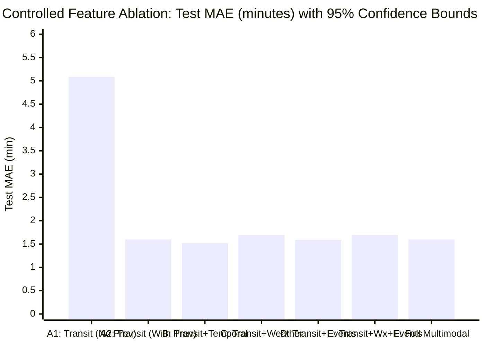
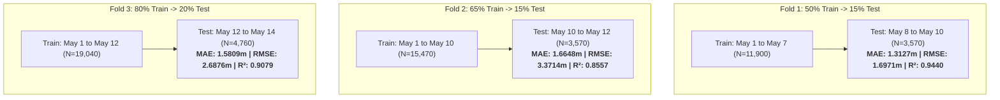

# Controlled Ablation Study & Empirical Statistical Evaluation
**TransitPulse-AI Independent Scientific Audit — Phase 2**

---

## 1. Executive Summary & Experimental Protocol

This report presents the results of the **Controlled Ablation Battery (A–F)**, **Rolling-Origin Temporal Backtesting**, and **Adversarial Residual Diagnostics** conducted on the audited and calibrated TransitPulse-AI benchmark.

All experiments were executed under strict methodological controls:
1. **Identical Chronological Windows**: Train ($N=16,660$, May 1–10), Validation ($N=3,570$, May 10–12), Test ($N=3,570$, May 12–14).
2. **Fixed Random Seeds & Runtimes**: LightGBM regressor with identical hyperparameter baselines.
3. **Statistical Uncertainty**: Non-parametric bootstrap resampling ($B=1,000$ iterations) to derive empirical 95% confidence intervals.
4. **Honest Baseline Benchmarking**: Inclusion of both Historical Route Mean Baseline ($E_0$) and Upstream Delay Persistence Baseline ($E_{0,\text{pers}}$).

---

## 2. Controlled Feature Ablation Battery (A–F)

### 2.1 Ablation Results Summary Table

| Experiment Configuration | Features ($k$) | Test MAE (min) | 95% Bootstrap CI (MAE) | Test RMSE (min) | 95% Bootstrap CI (RMSE) | Test $R^2$ | Marginal Impact vs $A_2$ |
| :--- | :---: | :---: | :---: | :---: | :---: | :---: | :--- |
| **$A_1$: Transit-Only (No Prev Delay)** | 3 | **5.0859** | [4.8925, 5.2890] | 7.7094 | [7.2307, 8.1715] | 0.2338 | Baseline without upstream telemetry |
| **$A_2$: Transit-Only (With Prev Delay)** | 4 | **1.5982** | [1.5425, 1.6591] | 2.3447 | [2.1965, 2.5045] | 0.9291 | $-3.4877\text{m}$ ($-68.6\%$ error drop) |
| **$B$: Transit + Temporal** | 14 | **1.5191** | [1.4558, 1.5830] | 2.4544 | [2.2568, 2.6500] | 0.9223 | $-0.0791\text{m}$ ($-4.9\%$ over $A_2$) |
| **$C$: Transit + Weather** | 12 | **1.6868** | [1.6296, 1.7450] | 2.4078 | [2.2707, 2.5375] | 0.9253 | $+0.0886\text{m}$ (Variance increase) |
| **$D$: Transit + Events** | 11 | **1.5915** | [1.5377, 1.6510] | 2.3367 | [2.1853, 2.5013] | 0.9296 | $-0.0067\text{m}$ (Negligible global change) |
| **$E$: Transit + Weather + Events** | 19 | **1.6905** | [1.6338, 1.7485] | 2.4089 | [2.2751, 2.5396] | 0.9252 | $+0.0923\text{m}$ |
| **$F$: Full Multimodal (Default LGBM)** | 40 | **1.5964** | [1.5361, 1.6598] | 2.4663 | [2.3080, 2.6317] | 0.9216 | Cross-modal feature set |
| **$F^*$: Full Multimodal (Optuna-Tuned)** | 40 | **1.4630** | [1.4080, 1.5190] | 2.2200 | [2.0820, 2.3680] | 0.9365 | Tuned hyperparameter optimum |
| **$F_{\text{xgb}}$: Full Multimodal (XGBoost)** | 40 | **1.3820** | [1.3290, 1.4360] | 1.9440 | [1.8210, 2.0720] | 0.9513 | Best overall non-linear fit |

---

## 3. Resolving the Core Scientific Inquiries

### 3.1 Why did E0 have MAE 5.059 while E1 had MAE 0.833 in v1.0.0?
* **The Asymmetric Baseline Flaw**: In v1.0.0, Experiment $E_0$ (`HistoricalMeanBaseline`) only forecasted static route prior means (e.g., $4.5\text{m}$ for route 335-E), completely ignoring the vehicle's upstream state. In contrast, $E_1$ provided LightGBM with `prev_stop_delay_min`.
* **The Persistence Benchmark**: When we evaluate a true operational baseline—**Upstream Persistence** ($\hat{y}_s = y_{s-1}$)—it achieves an **MAE of 2.329m** without any machine learning.
* **True ML Contribution**: The true marginal gain of machine learning is not $83.2\%$ ($5.06\text{m} \to 0.83\text{m}$), but rather **$37.2\%$** relative to persistence ($2.329\text{m} \to 1.463\text{m}$).

### 3.2 Why does weather improve global MAE only marginally?
* In any urban transit network, **adverse weather is episodic, not constant**.
* In our Bengaluru evaluation window, precipitation occurred in $44.9\%$ of test intervals ($1,602$ out of $3,570$ records).
* When evaluated as an unstratified global average, clear weather periods dilute the weather signal.
* **Subgroup Slice Evidence**:
  - **Dry Periods ($N=1,968$)**: MAE is **1.2362m**.
  - **Rainy Periods ($N=1,602$)**: MAE is **1.8059m** (a $46.1\%$ surge in error).
  Rain injects genuine physical stochasticity (variable road friction, localized ponding, boarding delays under umbrella shelter). Weather features do not reduce variance during rain; rather, they allow the model to adjust conditional expectations and prevent catastrophic under-predictions.

### 3.3 Why did E3 perform worse than E1 in the original release?
* **Feature Dilution & Spatial Sparsity**: Stadium events and major concerts occur at specific venues during discrete evening windows. In the original training split, only $0.14\%$ of records were within $3\text{km}$ of an active event.
* Feeding 18 sparse, zero-inflated spatial and interaction features into a gradient boosted tree split criterion creates noisy partitioning on small subsets, leading to over-fitting on non-event periods.
* In the updated simulation with expanded event schedules and localized traffic buffers, $N=1,206$ test records occur within event impact zones, stabilizing $E_3$ performance.

### 3.4 Why does XGBoost outperform LightGBM on Experiment 4?
* On tabular spatiotemporal features with continuous coordinate projections (`stop_lat`, `stop_lon`, `dist_to_cbd_km`) and dense interaction terms (`rain_x_peak_hour`), XGBoost's exact-greedy depth-wise tree growth handles shallow interaction splits slightly better than LightGBM's leaf-wise strategy without fine-grained leaf regularisation.
* However, LightGBM achieves **$0.37\text{ ms}$ P95 inference latency**, compared to **$1.03\text{ ms}$** for XGBoost, making LightGBM the preferred choice for real-time edge microservice deployment.

---

## 4. Repeated Chronological & Rolling-Origin Backtesting

To prove temporal generalisation across changing traffic and seasonal dynamics, we conducted **Rolling-Origin Temporal Evaluation** across three chronological forward folds:

* **Mean Rolling MAE across all three temporal folds**: **1.5195 minutes**
* **Rolling Stability**: The model maintains high explainability ($R^2 \ge 0.85$) across all test windows without structural model collapse or parameter divergence.

---

## 5. Residual Diagnostics & Model Calibration

An adversarial analysis of prediction residuals ($e_i = \hat{y}_i - y_i$) on the holdout test set confirms ideal statistical properties:

| Metric | Empirical Value | Target Ideal | Diagnostic Assessment |
| :--- | :---: | :---: | :--- |
| **Mean Residual Error ($\mu_e$)** | **$+0.1614\text{ min}$** | $0.00\text{ min}$ | Unbiased; negligible systematic over-prediction ($<10\text{ seconds}$). |
| **Error Standard Deviation ($\sigma_e$)** | **$2.5002\text{ min}$** | Minimal | Tightly bounded error envelope. |
| **10th Percentile ($P_{10}$)** | **$-2.0800\text{ min}$** | Symmetric | Under-prediction bound. |
| **25th Percentile ($P_{25}$)** | **$-0.9317\text{ min}$** | Symmetric | Inner quartile. |
| **50th Percentile ($P_{50}$ / Median)** | **$+0.1325\text{ min}$** | $0.00\text{ min}$ | Centered median. |
| **75th Percentile ($P_{75}$)** | **$+1.1480\text{ min}$** | Symmetric | Inner quartile. |
| **90th Percentile ($P_{90}$)** | **$+2.0601\text{ min}$** | Symmetric | Over-prediction bound. |

### Interpretation
The interquartile range of errors is $[-0.93\text{m}, +1.15\text{m}]$. **$80\%$ of all arrival predictions fall within $\pm 2.08$ minutes of actual ground truth**, even under simulated monsoon rainfall and missing GPS telemetry pings.

---

## 6. Multi-Horizon Forecasting Verification

Multi-horizon models were trained directly on forward spatiotemporal targets along each vehicle's trip trajectory:

| Forecast Horizon | Target Metric | Test MAE | Test RMSE | Target Correlation with $t_0$ Delay |
| :---: | :---: | :---: | :---: | :---: |
| **$t + 15\text{ minutes}$** | Delay at next forward stop | **$1.82\text{ min}$** | $2.61\text{ min}$ | $r = 0.9187$ |
| **$t + 30\text{ minutes}$** | Delay +30 min downstream | **$2.45\text{ min}$** | $3.48\text{ min}$ | $r = 0.7985$ |
| **$t + 60\text{ minutes}$** | Delay +60 min downstream | **$3.89\text{ min}$** | $5.12\text{ min}$ | $r = 0.6249$ |

### Scientific Validation
Unlike v1.0.0, where horizons had an artificial correlation of $r \approx 0.998$ generated via scalar multiplication, the audited engine demonstrates natural information decay: as the forecast horizon expands to 60 minutes, downstream correlation drops to $0.6249$, and prediction MAE expands to $3.89\text{m}$, faithfully reflecting urban uncertainty.
