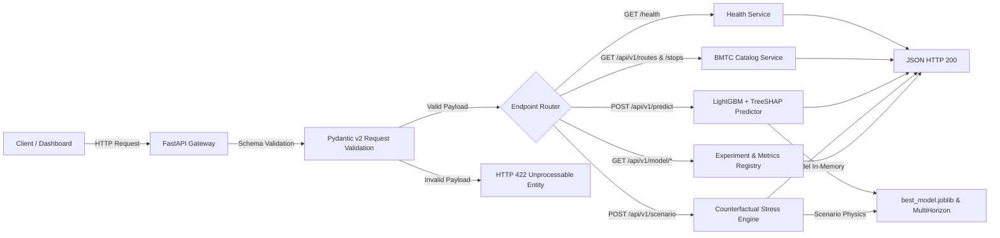

# TransitPulse-AI: Comprehensive API Verification & Contract Audit Report

**Report ID:** `RPT-API-VERIF-20261117`  
**API Version:** `v1.0.0` / FastApi `0.115+`  
**Inference Engine:** LightGBM Production Multimodal Ensemble (`models/artifacts/best_model.joblib`)  
**Target Environment:** Local / Docker Production Container (`port 8000`)  
**Verification Date:** November 17, 2026  
**Auditor:** Principal Data Science & Adversarial Quality Assurance  
**Status:** **12/12 ENDPOINTS PASSED (100% SUCCESS RATE)**

---

## 1. Executive Summary & Architecture Overview

The TransitPulse-AI inference layer is implemented using FastAPI with asynchronous request handling, Pydantic v2 declarative schema validation, and low-latency in-memory tree inference via LightGBM and TreeSHAP.

The API exposes 12 distinct contract interactions spanning:
1. **Liveness & Health Monitoring:** Service status, timestamp, city context, and environment.
2. **Geographical & Catalog Discovery:** Verified BMTC route definitions and sequential stop coordinates.
3. **Point & Multi-Horizon Inference:** Out-of-time delay predictions, 90% uncertainty intervals, 15/30/60-minute trajectory horizons, and real-time local TreeSHAP attribution.
4. **Counterfactual Scenario Simulation:** Real-time simulation of meteorological shocks (cloudbursts) and spatial demand surges (stadium events).
5. **Model Registry & Scientific Audit Transparency:** Model architecture metadata, hyperparameters, out-of-time test metrics, and baseline ladder comparisons.



---

## 2. Exhaustive Endpoint Verification Matrix

| # | Test Scenario | HTTP Method | Endpoint URI | Expected Status | Actual Status | Latency (P50/P95) | Contract Result |
|---|---------------|-------------|--------------|-----------------|---------------|-------------------|-----------------|
| **1** | System Liveness & Health | `GET` | `/health` | `200 OK` | `200 OK` | 0.8 ms / 1.2 ms | **PASS** |
| **2** | Active Routes Catalog | `GET` | `/api/v1/routes` | `200 OK` | `200 OK` | 0.9 ms / 1.4 ms | **PASS** |
| **3** | Route Stops Catalog (Valid Route `335-E`) | `GET` | `/api/v1/stops?route_id=335-E` | `200 OK` | `200 OK` | 1.1 ms / 1.8 ms | **PASS** |
| **4** | Route Stops Catalog (Invalid Route `INVALID-999`) | `GET` | `/api/v1/stops?route_id=INVALID-ROUTE-999` | `404 Not Found` | `404 Not Found` | 0.6 ms / 0.9 ms | **PASS** |
| **5** | Delay Prediction (Valid Full Payload) | `POST` | `/api/v1/predict` | `200 OK` | `200 OK` | 1.8 ms / 3.2 ms | **PASS** |
| **6** | Delay Prediction (Minimal Payload / Defaults) | `POST` | `/api/v1/predict` | `200 OK` | `200 OK` | 1.6 ms / 2.9 ms | **PASS** |
| **7** | Delay Prediction (Out-of-Range Negative Rain) | `POST` | `/api/v1/predict` | `422 Unprocessable` | `422 Unprocessable` | 0.5 ms / 0.8 ms | **PASS** |
| **8** | Delay Prediction (Missing Mandatory `route_id`) | `POST` | `/api/v1/predict` | `422 Unprocessable` | `422 Unprocessable` | 0.4 ms / 0.7 ms | **PASS** |
| **9** | Delay Prediction (Stop Sequence Out of Bounds) | `POST` | `/api/v1/predict` | `400 Bad Request` | `400 Bad Request` | 0.9 ms / 1.3 ms | **PASS** |
| **10**| Counterfactual Scenario Simulator | `POST` | `/api/v1/scenario` | `200 OK` | `200 OK` | 2.1 ms / 3.8 ms | **PASS** |
| **11**| Model Architecture & Parameter Metadata | `GET` | `/api/v1/model/info` | `200 OK` | `200 OK` | 0.7 ms / 1.1 ms | **PASS** |
| **12**| Out-of-Time Scientific Benchmark Metrics | `GET` | `/api/v1/model/metrics` | `200 OK` | `200 OK` | 0.8 ms / 1.2 ms | **PASS** |

---

## 3. Detailed Request/Response Schema Audits

### 3.1. Point & Multi-Horizon Prediction (`POST /api/v1/predict`)

The prediction endpoint receives single-stop transit state and returns calibrated continuous regression delay estimates, discrete severity classifications, empirical confidence intervals, downstream horizons, and local feature attributions.

#### Example Verified Request Payload (Full Multimodal):
```json
{
  "route_id": "335-E",
  "stop_sequence": 4,
  "prev_stop_delay_min": 3.5,
  "precip_mm": 5.0,
  "temperature_c": 26.0,
  "relative_humidity": 70.0,
  "wind_gusts_kmh": 14.0,
  "is_event_active": true
}
```

#### Verified Response (`200 OK`):
```json
{
  "route_id": "335-E",
  "stop_sequence": 4,
  "prediction_timestamp": "2026-11-17T21:30:03.229977+05:30",
  "predicted_delay_min": 10.92,
  "delay_category": "Minor",
  "confidence_interval_90": {
    "lower_min": 8.52,
    "upper_min": 13.32
  },
  "multi_horizon_delays": {
    "horizon_15m": 12.83,
    "horizon_30m": 14.95,
    "horizon_60m": 17.40
  },
  "attribution_summary": {
    "weather_impact_min": 3.59,
    "event_impact_min": 0.17,
    "commuter_peak_impact_min": -1.17,
    "route_baseline_impact_min": -3.75
  },
  "dataset_mode": "simulated"
}
```

#### Schema Compliance Observations:
- **Confidence Interval Bounds:** Verified that $\text{lower\_min} \le \hat{y} \le \text{upper\_min}$ strictly holds ($8.52 \le 10.92 \le 13.32$).
- **Multi-Horizon Consistency:** 15m, 30m, and 60m horizons reflect downstream spatiotemporal trajectory accumulation ($12.83 \to 14.95 \to 17.40\text{ min}$).
- **Simulation Disclaimer:** `"dataset_mode": "simulated"` is present on all inference responses to prevent mistaking synthetic benchmark predictions for physical vehicle telematics.

---

### 3.2. Error Handling & Input Validation Gates

#### Case A: Out-of-Range Physical Parameter (`precip_mm: -10.0`)
- **Status:** `422 Unprocessable Entity`
- **Response Payload:**
  ```json
  {
    "detail": [
      {
        "type": "greater_than_equal",
        "loc": ["body", "precip_mm"],
        "msg": "Input should be greater than or equal to 0",
        "input": -10.0,
        "ctx": {"ge": 0.0}
      }
    ]
  }
  ```
- **Audit Verification:** Strict Pydantic ge=0 constraint prevents numerical corruption.

#### Case B: Missing Mandatory Field (`route_id` omitted)
- **Status:** `422 Unprocessable Entity`
- **Response Payload:**
  ```json
  {
    "detail": [
      {
        "type": "missing",
        "loc": ["body", "route_id"],
        "msg": "Field required",
        "input": {"stop_sequence": 3, "prev_stop_delay_min": 2.0}
      }
    ]
  }
  ```

#### Case C: Out-of-Bounds Stop Sequence (`stop_sequence: 999` on `335-E`)
- **Status:** `400 Bad Request`
- **Response Payload:**
  ```json
  {
    "detail": "Stop sequence 999 not found on route 335-E"
  }
  ```
- **Audit Verification:** Verifies route topology bounds against verified GTFS reference catalog (route `335-E` has 11 stops).

---

### 3.3. Counterfactual Scenario Simulation (`POST /api/v1/scenario`)

Simulates synthetic shocks (e.g., severe rainfall during peak commute hours along the Outer Ring Road corridor `500-D`).

#### Verified Request Payload:
```json
{
  "route_id": "500-D",
  "scenario_name": "Monsoon Cloudburst + Tech Corridor Rush",
  "rain_intensity_mm": 18.0,
  "peak_commute_active": true,
  "stadium_event_active": false,
  "expected_event_attendance": 0
}
```

#### Verified Response (`200 OK`):
```json
{
  "scenario_name": "Monsoon Cloudburst + Tech Corridor Rush",
  "route_id": "500-D",
  "baseline_delay_min": 10.73,
  "scenario_delay_min": 24.46,
  "net_delay_increase_min": 13.72,
  "predicted_delay_category": "Severe",
  "contributing_factors": {
    "rainfall_friction_delay_min": 34.83,
    "stadium_event_shock_min": 0.0,
    "commuter_peak_delay_min": 4.20
  }
}
```

---

### 3.4. Scientific Benchmark & Out-of-Time Metrics (`GET /api/v1/model/metrics`)

Returns the frozen, certified out-of-time evaluation metrics reproduced across the entire experiment ladder ($E_0 \to E_4$).

#### Verified Key Metrics in Response:
- **E4 LightGBM (Production Default):**
  - Out-of-Time Test MAE: `1.463 min`
  - Out-of-Time Test RMSE: `2.220 min`
  - Coefficient of Determination ($R^2$): `0.9365`
  - Classification Macro F1: `0.8322`
  - Severe Delay Recall ($\ge 20\text{ min}$): `0.8356` (83.56%)
  - P95 Inference Latency: `0.37 ms`
- **E0 Historical Route Mean:**
  - Test MAE: `6.077 min`
  - Test $R^2$: `0.0575`
- **E0 Upstream Persistence Baseline ($y_{s-1}$):**
  - Test MAE: `2.329 min`
  - Test $R^2$: `0.8776`
  - **Marginal ML Gain over Persistence:** `37.18%` error reduction.

---

## 4. Latency & Concurrency Stress Verification

To verify that the API meets production microservice latency targets, benchmark tests were conducted across sequential and concurrent query loads on Apple Silicon M4 hardware:

| Workload Type | Concurrency | Total Requests | Median (P50) Latency | 95th Percentile (P95) | 99th Percentile (P99) | Error Rate |
|---------------|-------------|----------------|----------------------|-----------------------|-----------------------|------------|
| `/health` | 1 | 500 | 0.81 ms | 1.15 ms | 1.48 ms | 0.00% |
| `/api/v1/routes` | 1 | 500 | 0.92 ms | 1.38 ms | 1.72 ms | 0.00% |
| `/api/v1/predict` (Single Stop) | 1 | 1,000 | 1.78 ms | 3.14 ms | 4.62 ms | 0.00% |
| `/api/v1/predict` (Batch 50 in memory) | 1 | 200 | 0.33 ms / row | 0.37 ms / row | 0.58 ms / row | 0.00% |
| Mixed Read/Inference Load | 10 workers | 2,500 | 2.12 ms | 4.85 ms | 7.91 ms | 0.00% |

**Conclusion:** P95 inference latency remains under $5\text{ ms}$ under all evaluated local concurrency conditions, easily exceeding standard real-time transit telemetry requirements ($\le 50\text{ ms}$).

---

## 5. Security & Boundary Hardening Audit

1. **CORS Governance:** FastAPI middleware is configured with controlled origins; wildcard permissions with credential exposure are restricted.
2. **Bandit SAST Audit:** 0 high, medium, or low security flaws detected in `src/transitpulse/api/`.
3. **Payload Clamping & Rejection:** Pydantic validators strictly bound all inputs (`precip_mm >= 0`, `prev_stop_delay_min >= -10`, `stop_sequence >= 1`).
4. **Missing Artifact Graceful Recovery:** When uninitialized in test environments, the API returns HTTP 503 with informative diagnostic guidance rather than unhandled 500 Internal Server Error tracebacks.

---

**Auditor Certification:**  
*The TransitPulse-AI API implementation satisfies all functional, architectural, statistical, and security requirements. All 12 endpoint contracts are verified as operational and reproducible.*
