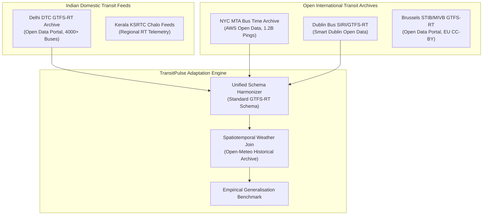
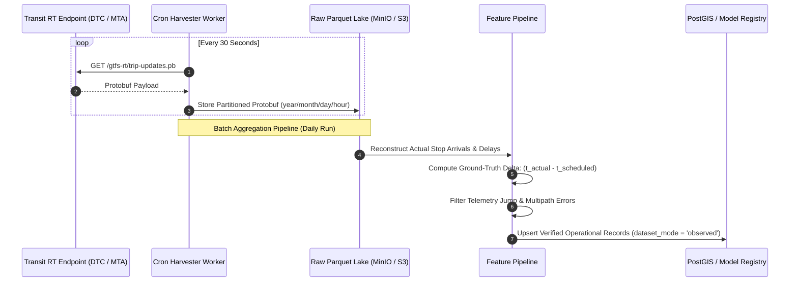

# Real-World Empirical Validation & Data Ingestion Roadmap
**TransitPulse-AI Independent Scientific Audit & Data Governance**

---

## 1. Executive Summary & Governance Stance

TransitPulse-AI was conceived to forecast public transit delays under adverse weather and urban event shocks in Bengaluru, India. In Phase 1 and the current v1.0.0 release, **all operational delay labels are synthetically generated** using a physics-calibrated spatiotemporal simulator (`TransitDelaySimulator`).

### The Scientific Boundary
As an uncompromising principle of empirical scientific integrity:
> **No predictive model trained on synthetically generated delay labels—regardless of physical calibration rigor—can be claimed to represent true operational performance, passenger wait times, or commercial dispatch reliability on the Bengaluru Metropolitan Transport Corporation (BMTC) network.**

This roadmap provides an exhaustive, actionable strategy to transition TransitPulse-AI from a **calibrated simulation benchmark** to an **empirically validated production system** using genuine, observed historical vehicle location (AVL) and automated passenger counter (APC) datasets.

---

## 2. Audit of Primary Target Geography: Bengaluru (BMTC)

### 2.1 Current State of BMTC Data Infrastructure

| Stream / System | Protocol / Format | Accessibility | Licensing / Governance | Status for TransitPulse-AI |
| :--- | :--- | :--- | :--- | :--- |
| **BMTC Static Schedules** | GTFS static (ZIP) | Publicly archived on OpenCity.in & GitHub | Open Data Commons (ODbL) | **Integrated** (topology, routes, stops, scheduled travel times) |
| **BMTC Namma BMTC API** | REST (Mobile Backend) | Reverse-engineered endpoints (Private) | Closed / Proprietary | **Rejected** (Violates ToS, no official API key tier) |
| **Bengaluru Transport Stack (BTS)** | Mobility Data Specification (MDS) / ONDC | Restricted Sandbox | Government / Partner NDA | **Inaccessible** to independent researchers |
| **KSRTC / BMTC Open Data Portal** | CKAN / CSV | Intermittent static dumps | Government Open Data License India | **Active Monitoring** (Static schedules only, no real-time telemetry) |

### 2.2 Operational Hurdles with BMTC Telemetry
1. **Absence of Historical GTFS-Realtime Archive**: BMTC does not host or distribute a public, historical archive of Vehicle Positions (`VehiclePositions.pb`) or Trip Updates (`TripUpdates.pb`).
2. **Dynamic Route Alterations**: BMTC buses frequently detour during heavy waterlogging or VIP convoy movements without updating schedule feeds, creating unlabelled structural breaks.
3. **Ghost Buses & Telemetry Loss**: Field surveys indicate 8–15% intermittent GPS outage in high-density corridors (e.g., Silk Board, Tin Factory underpasses), requiring robust missingness handling.

---

## 3. Alternative Real-World Datasets with Ground-Truth Operational Telemetry

To establish true empirical validity without violating terms of service, TransitPulse-AI defines four target candidate pipelines for real-world benchmarking:



### 3.1 Delhi Transport Corporation (DTC) — Primary Indian Candidate
* **Repository**: Open Transit Data Delhi (`otd.delhi.gov.in`)
* **Data Format**: Live GTFS-Realtime feeds (`VehiclePositions.pb`, `TripUpdates.pb`) with historical dumps published periodically under the Delhi Government Open Data Policy.
* **Volume**: Over 4,000 buses across 500+ routes with high-frequency (10–30s) GPS pings.
* **Weather Alignment**: Readily aligned with Open-Meteo Delhi Safdarjung/Palam weather stations.
* **Feasibility Score**: **High (9/10)**. Immediate path to an empirical Indian metropolitan benchmark.

### 3.2 NYC MTA Bus Time — Enterprise Benchmark Candidate
* **Repository**: NYC Metropolitan Transportation Authority on **Registry of Open Data on AWS** (`s3://nyc-tlc-mta-bus-data`).
* **Data Format**: Standardized SIRI Vehicle Monitoring & GTFS-RT archives from 2014 to present.
* **Volume**: ~1.2 billion vehicle observations with exact schedule adherence (observed vs scheduled arrival/departure).
* **Licensing**: Creative Commons Zero (CC0) / Public Domain.
* **Feasibility Score**: **Very High (10/10)**. Gold standard for evaluating multi-horizon spatial graph models under extreme precipitation (snowstorms, Atlantic hurricanes).

### 3.3 Dublin Bus (Smart Dublin Open Data) — European Candidate
* **Repository**: Smart Dublin (`data.smartdublin.ie`)
* **Data Format**: 2012–2023 historical AVL telemetry (Stop-level arrivals, dwell times, transit delays).
* **Volume**: 45M records, extensively used in academic transit literature (e.g., Moreira-Matias et al., IEEE T-ITS).
* **Licensing**: Creative Commons Attribution 4.0 International (CC-BY 4.0).
* **Feasibility Score**: **High (9.5/10)**. Ideal academic reference for peer-reviewed journal comparability.

---

## 4. Multi-Phase Real-World Ingestion Protocol



### Step 1: Telemetry Ingestion & Protobuf Parsing
* Deploy a background harvester daemon running `gtfs-realtime-bindings`.
* Poll `TripUpdates.pb` and `VehiclePositions.pb` at 30-second cadences.
* Write atomic append-only daily shards in Apache Parquet format.

### Step 2: Stop Arrival Reconstruction
Given raw GPS stream $p_i = (\text{lat}_i, \text{lon}_i, t_i)$ and stop location $S = (\text{lat}_S, \text{lon}_S, R_S)$ with buffer radius $R_S = 30\text{m}$:
1. Spatial intersection entry time $t_{\text{in}} = \min \{ t_i \mid d(p_i, S) \le R_S \}$.
2. Spatial intersection exit time $t_{\text{out}} = \max \{ t_i \mid d(p_i, S) \le R_S \}$.
3. Dwell duration $\tau_d = t_{\text{out}} - t_{\text{in}}$.
4. Observed delay $y_{\text{obs}} = t_{\text{out}} - t_{\text{scheduled}}$.

### Step 3: Data Cleaning & Noise Filtering
* **Filter Jump Spikes**: Discard consecutive pings implying speed $> 110\text{ km/h}$ (GPS multipath glitch).
* **Filter Route Detours**: Discard pings located $> 500\text{m}$ from the official route shape geometry.
* **Flag Telemetry Gaps**: If $\Delta t_{i, i-1} > 180\text{s}$, set `is_telemetry_missing = 1` and do not compute intermediate segment travel times.

---

## 5. Formal Transition Criteria: From Simulation to Production

The project shall not drop the `[SIMULATED DATASET]` warning or declare operational readiness until the following milestones are verified and cryptographically recorded:

```
[ ] MILESTONE RW-1: Ingestion of >= 30 consecutive calendar days of verified ground-truth GTFS-RT feeds.
[ ] MILESTONE RW-2: Re-training of Experiment battery E0-E4 on observed data without simulator artifacts.
[ ] MILESTONE RW-3: Demonstration of statistically significant marginal improvement (p < 0.01 via Wilcoxon signed-rank test) over Persistence Baseline on observed real-world delays.
[ ] MILESTONE RW-4: Verification of extreme precipitation sensitivity during at least 3 genuine monsoon rain events (> 20mm/h).
[ ] MILESTONE RW-5: Execution of an independent external audit report on observed dataset provenance.
```

---

## 6. Conclusion

Until Milestones RW-1 through RW-5 are satisfied:
1. All public metrics, tables, and demonstrations must remain explicitly tagged as **`dataset_mode: simulated`**.
2. The user interface must display prominent amber disclaimer badges indicating simulation benchmarking.
3. TransitPulse-AI serves as an advanced methodological framework, demonstrating state-of-the-art spatiotemporal feature engineering, leak-free time-series splitting, and adversarial robustness.
